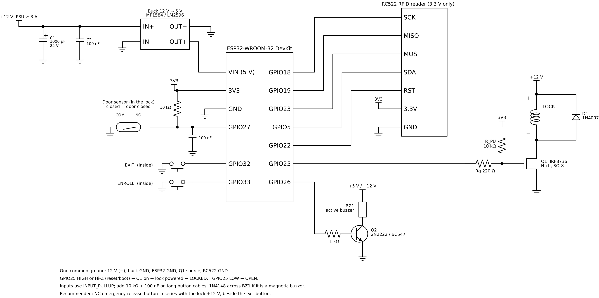
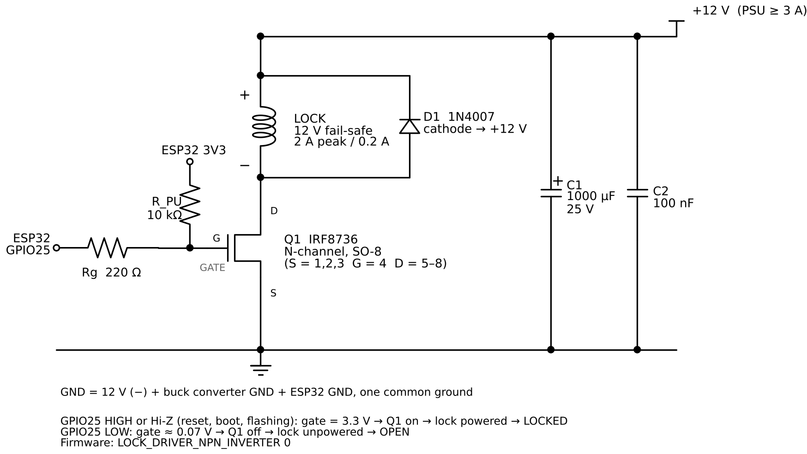
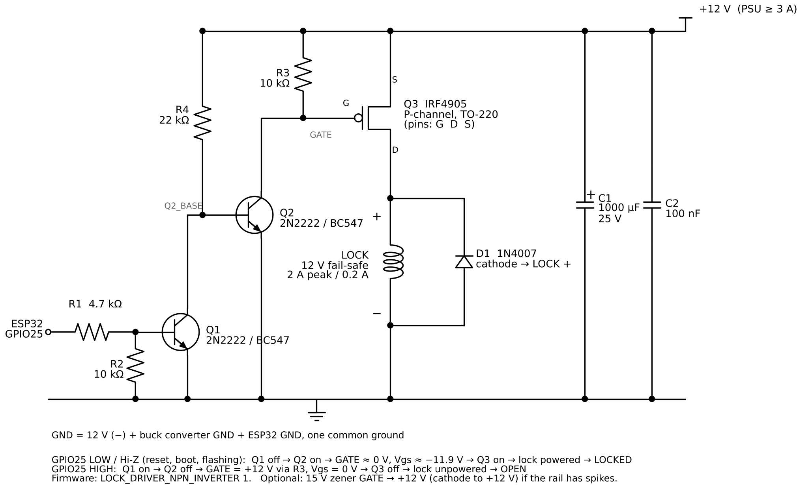

# Lock_Door_RFID

ESP32-WROOM-32 controller for a 12 V **fail-safe** electric lock (powered = locked, unpowered = open), opened by an RC522 RFID card or an inside exit button, with an enroll button for adding/removing cards, an active buzzer and door monitoring through the lock's built-in magnetic door sensor (COM/NO).

Framework: Arduino on PlatformIO (`espressif32@^6.9.0`, Arduino core 2.0.17), library `miguelbalboa/MFRC522@^1.4.11`.

```
platformio.ini
include/config.h   <- pins, driver topology, timings, sensor polarity
src/main.cpp       <- firmware
docs/              <- schematics: schemdraw scripts + PNG/SVG
```

---

## 1. Lock specifications

| Parameter | Value |
|---|---|
| Type | 12 V DC electric bolt lock, **fail-safe** (power-to-lock) |
| Logic | Powered = locked, unpowered = open (also opens on power loss) |
| Supply | 12 V DC |
| Current | **2 A** inrush while the bolt is driven, **200 mA** hold |
| Power | 24 W peak, 2.4 W hold |
| Door sensor | Built-in magnetic sensor, dry contact COM/NO, closed = door closed |
| Relock-delay selector | 0 / 3 / 6 s on the lock (`LOCK_HW_DELAY_MS` in `config.h` must match) |
| Bolt drop condition | Lock powered **and** door magnet detected, then the selector delay |
| Wires | Lock +, Lock − (power), COM, NO (door sensor) |

The lock is switched low side by an IRF8736 driven directly from GPIO25 (section 5). The 12 V supply must cover the 2 A inrush: ≥ 3 A with the electronics and margin.

---

## 2. Wiring diagram



Full-resolution vector version: [`docs/wiring.svg`](docs/wiring.svg). Generated by `docs/draw_wiring.py` (schemdraw); regenerate from the `docs/` folder with `python draw_wiring.py`. Driver details and alternatives are in section 5.

---

## 3. Behaviour

| Event | Action | Buzzer |
|---|---|---|
| Boot | Lock driven LOCKED first thing in `setup()`. If the door is open, lock power is removed until the door closes and settles | 3 short |
| Stored card | Unlock for `unlock time` (default 10 s), then relock. Re-presenting extends the time. If the door is still open at relock, the lock stays unpowered until the door has been closed for `RELOCK_CLOSE_DELAY_MS` (1 s) | 1 short (120 ms) |
| Door opened and closed again during the unlock window | Relock once the door has stayed closed for `RELOCK_CLOSE_DELAY_MS` (1 s), no waiting for the rest of the unlock time (`RELOCK_ON_DOOR_CLOSE`) | none |
| Unknown card | Denied. 5 in a row -> reader ignored for 30 s (LED slow blink) | 1 long (700 ms) / 3 long on lockout |
| Exit button | Unlock for `unlock time` | 1 short |
| Enroll button short press | Toggle enroll mode (LED fast blink, auto-exit after 15 s without a card) | 3 short in / 1 medium out |
| Card in enroll mode, not stored | Added to NVS | short + long |
| Card in enroll mode, already stored | **Removed** from NVS | long + short |
| Card in enroll mode, store full (50) | Not added | 4 short |
| Enroll button held 10 s | Erase all cards (1 Hz ticks from 2 s) | 1.2 s beep |
| Door open for 15 s continuously after relock (`DOOR_OPEN_ALARM_MS`) | Door-left-open alarm until the door closes or a card/exit button unlocks | 3 short, every 3 s |
| Door opens while locked (bolt already dropped) | **Forced-door alarm** until the door closes or a card/exit button unlocks | 4 long, every 3 s |

Cards are stored in NVS (`Preferences`, namespace `doorlock`, key `cards`) as one blob of 11-byte UID records; the card count is the blob length / 11. They survive power loss and re-flashing (unless you erase flash). The unlock time is stored in NVS too.

- An NVS blob write is atomic: a power cut while adding or removing a card keeps either the old or the new list, never a mix. (v1.0 kept a separate `count` key, and a power cut between the two writes made the boot code discard the whole list; v1.1 reads the old format and deletes the `count` key on first boot. A v1.0 erase wrote `count` = 0 before removing `cards`; if the power was cut in between, v1.1 honours `count` = 0: it removes the stale list, then the `count` key. If that fails, it starts empty and refuses every card-list write (long beep, `NOT added`) until both are removed, so a later boot can never apply that erase to a new list.)
- The new list is written to NVS first and becomes active only if the write succeeds. If a write fails, nothing changes, the buzzer gives a long beep and the log says `NOT added` / `NOT removed` / `NOT erased`.

Every 5 s (`RC522_CHECK_INTERVAL_MS`) the firmware checks the RC522: `VersionReg` (SPI alive), `TxControlReg` bits 1..0 (antenna drivers on), `TxASKReg` = 0x40 and RxGain = max (configuration still loaded). After ESD or a supply glitch the reader can reset its registers and stop reading cards while `VersionReg` still answers; any failed check re-initialises it and logs `[RFID] reader <fault> (...), re-init`.

### Door sensor and relock-delay selector (0 / 3 / 6 s)

The COM/NO contact in the lock is a **magnetic door sensor**: closed = door closed. The lock itself drops the bolt only when it is powered **and** the door is closed, after the selector delay.

Sequence with `RELOCK_ON_DOOR_CLOSE 1` and a 10 s unlock time:

1. Card / exit button -> lock unpowered, bolt retracts.
2. Door opens -> firmware notes the passage.
3. Door closes and stays closed for `RELOCK_CLOSE_DELAY_MS` (1 s) -> firmware powers the lock (does not wait for the rest of the 10 s). If the door reopens within that second (rebound after a slam), the delay restarts on the next close.
4. Bolt drops after the selector delay: 0 s, 3 s or 6 s.

If nobody opens the door, the lock is powered again when the 10 s expire, and the bolt drops after the selector delay.

**The lock is never powered while the door is open.** A powered lock drops the bolt the moment it sees the door magnet, so a door closed onto a powered lock gets the bolt while it is still moving or rebounding (bolt hits the strike, the lock retries, rapid lock/unlock). If the unlock time expires with the door open (or the ESP32 boots with the door open), the firmware marks the door LOCKED but keeps the lock unpowered (`[LOCK] LOCKED, lock power deferred ...`) and powers it only after the door has stayed closed for `RELOCK_CLOSE_DELAY_MS`. The door-left-open alarm still runs 15 s after the relock.

Recommended: selector at **0 s**. The bolt can't drop into an open door (the lock waits for the magnet), so there is no reason for a hardware delay, and the open time is set from firmware only (`time <ms>`, saved in NVS). If you use 3 s or 6 s, set `LOCK_HW_DELAY_MS` in `config.h` to match: the forced-door alarm is armed only after the door has been closed and the lock powered for `LOCK_HW_DELAY_MS + BOLT_SETTLE_MS` (1 s), so a door pulled open during the delay (bolt still up) is not reported as forced.

The 2 A inrush is drawn when the bolt is driven (at the end of the delay), with the MOSFET already fully on.

### Serial console (115200 baud)

| Command | Effect |
|---|---|
| `help` | List commands |
| `list` | Show stored UIDs and unlock time |
| `open` | Unlock now |
| `enroll` | Toggle enroll mode |
| `clear` | Erase all cards |
| `time <ms>` | Set unlock time, 500..60000 ms, saved to NVS |

The log prints every door change as `[DOOR] OPEN` / `[DOOR] CLOSED`. If it reads inverted, flip `DOOR_SENSE_CLOSED_IS_DOOR_CLOSED`.

---

## 4. Pin map

| ESP32 GPIO | Function | Connects to | Notes |
|---|---|---|---|
| 18 | VSPI SCK | RC522 SCK | |
| 19 | VSPI MISO | RC522 MISO | |
| 23 | VSPI MOSI | RC522 MOSI | |
| 5 | SS | RC522 SDA | strapping pin, idles high, OK |
| 22 | RC522 RST | RC522 RST | |
| 25 | Lock drive | Rg 220 Ω -> IRF8736 gate (option B, current) / R1 -> Q1 base (options A/C) | 10 kΩ gate pull-up to 3.3 V |
| 26 | Buzzer | NPN base via 1 kΩ | |
| 27 | Door sensor | Lock NO (COM -> GND), magnetic, closed = door closed | INPUT_PULLUP + external 10 kΩ |
| 32 | Exit button | Button -> GND | INPUT_PULLUP |
| 33 | Enroll button | Button -> GND | INPUT_PULLUP, mount **inside** |
| 2 | Status LED | On-board LED | strapping pin, LED only |
| 3V3 | | RC522 3.3V | **RC522 is 3.3 V only** |
| GND | | Common ground (ESP, RC522, MOSFET source, 12 V –) | |

GPIO 34–39 were avoided (no internal pull-ups), GPIO 0/12/15 avoided (boot straps), GPIO 6–11 are flash.

---

## 5. Lock driver

The lock needs 2 A inrush and 200 mA hold at 12 V, so it is switched by a power MOSFET. An NPN cannot do it directly from a GPIO: 2 A at β≈50 needs Ib≈40 mA (above the ESP32 pin rating), and a Darlington (TIP120) drops Vce(sat)≈1–2 V -> 2–4 W at 2 A.

Schematics are generated by `docs/draw_lock_driver.py` (schemdraw), PNG + SVG in `docs/`.

### Option B (current hardware): IRF8736 low side, driven directly from GPIO25 (`LOCK_DRIVER_NPN_INVERTER 0`)



IRF8736TRPBF: N-channel, SO-8, VDS 30 V, ID 18 A, Rds(on) 4.8 mΩ @ Vgs = 10 V, Vgs(th) 1.8 V typ (1.35–2.35 V), Vgs max ±20 V, PD 2.5 W.

| Net | Connected to |
|---|---|
| +12V | lock +, D1 (1N4007) cathode, C1 +, C2 |
| DRAIN | Q1 pins 5–8, lock −, D1 anode |
| GATE | Q1 pin 4, Rg (220 Ω) pin 2, R_PU (10 kΩ) pin 2 |
| GPIO25 | Rg pin 1 |
| 3V3 | R_PU pin 1 (ESP32 3V3 pin) |
| GND | Q1 pins 1–3, C1 −, C2, 12 V (−), buck GND, ESP32 GND |

The gate resistor goes to **3.3 V (pull-up), not to GND**: while the ESP32 is in reset, booting or being flashed, GPIO25 is Hi-Z, R_PU holds the gate at 3.3 V and the lock stays powered (LOCKED). With a pull-down the door would open on every reset.

| GPIO25 | Gate | Q1 | Lock |
|---|---|---|---|
| HIGH | 3.3 V | on | powered -> **LOCKED** |
| Hi-Z (reset, boot, flashing) | 3.3 V via R_PU | on | powered -> **LOCKED** |
| LOW | 3.3·220/(10 k + 220) = 0.07 V | off | unpowered -> **OPEN** |

Calculations:

| Quantity | Formula | Value |
|---|---|---|
| Gate overdrive | Vgs − Vgs(th) = 3.3 − 1.8 | **1.5 V** typ, 0.95 V worst case (Vgs(th) = 2.35 V) |
| Off-state margin | 0.07 V vs Vgs(th) min 1.35 V | 1.28 V margin |
| GPIO peak current (gate charge) | 3.3 / 220 | **15 mA** (< 20 mA recommended, 40 mA abs max) |
| GPIO sink current while OPEN | 3.3 / (10 k + 220) | 0.32 mA |
| Rds(on) at Vgs = 3.3 V | not specified (4.8 mΩ @ 10 V); **assumed ≤ 20 mΩ** (4× the 10 V value) | |
| Conduction loss inrush | 2²·0.020 | **80 mW** |
| Conduction loss hold | 0.2²·0.020 | **0.8 mW** |
| Temperature rise | 80 mW · 50 °C/W (SO-8 on 1 in² copper) | ≈ **4 °C** |
| Switching time | Qg (< 30 nC) / 15 mA | < 2 µs, switching loss negligible |
| Vds at turn-off | 12 V + Vf(D1) 0.7 V | 12.7 V < 30 V rating |

No heatsink needed. To verify the 3.3 V drive on your part: with the lock powered (locked, 0.2 A), measure drain-to-source. Expect < 5 mV (≤ 20 mΩ). Above 50 mV means the gate is not fully enhanced.

Build notes: SO-8 needs an SO-8 to DIP adapter or a small PCB. Tie pins 1–3 together (S) and 5–8 together (D), and use short, wide traces/wires on the drain and source for the 2 A inrush. Place R_PU and Rg next to the MOSFET.

### Alternative drivers

Kept for reference if you change the MOSFET.

#### Option A: N-MOSFET low side, NPN pre-driver + 12 V gate pull-up (`LOCK_DRIVER_NPN_INVERTER 1`)

```
 +12V ────────┬──────────────────────┬────────────┐
              │                      │            │
            R3 10k                 LOCK (+)    D1 1N4007
              │                    LOCK (–)    (cathode to +12V)
              │                      │            │
              ├─────────── G         ├────────────┘
              │          Q2 IRFZ44N  D
              │                      S
              C (Q1 collector)       │
 GPIO25 ─R1 4.7k─┬─ B  Q1 2N2222     │
                 │     /BC547        │
               R2 10k  E             │
                 │     │             │
 GND ────────────┴─────┴─────────────┴──── 12V GND ── ESP32 GND
```

C1 1000 µF/25 V + 100 nF across the 12 V rail at the lock terminals.

Logic: GPIO25 LOW or Hi-Z -> Q1 off -> gate pulled to 12 V -> lock powered -> **LOCKED**. GPIO25 HIGH -> Q1 saturates -> gate at ~0.1 V -> lock unpowered -> **OPEN**. The lock therefore stays locked while the ESP32 is in reset, booting, or being flashed.

Calculations:

| Quantity | Formula | Value |
|---|---|---|
| Q1 base current | (3.3 − 0.7)/4.7 k − 0.7/10 k | 0.553 − 0.070 = **0.48 mA** |
| Q1 collector current | (12 − 0.1)/10 k | **1.19 mA** |
| Forced β | 1.19/0.48 | **2.5** (hfe min ≈ 35–100 -> hard saturation) |
| Vgs (locked) | 12 V (Q1 off, no load on gate) | 12 V < 20 V max |
| R3 dissipation (door open) | 12²/10 k | 14.4 mW |
| Gate charge time (turn-on) | Miller plateau ≈ 5 V: Ig ≈ (12−5)/10 k = 0.7 mA; Qgd = 26 nC -> 26 n/0.7 m | ≈ **37 µs** in linear region, full Qg 63 nC ≈ 90–110 µs |
| Switching energy per lock event | ½·12 V·2 A·37 µs | ≈ **0.44 mJ** (negligible, a few events per day) |
| Turn-off (unlock) | Q1 sinks ≥ β·Ib ≈ 100·0.48 mA ≈ 48 mA | ≈ 1–2 µs |
| Conduction loss inrush | I²·Rds = 2²·0.0175 | **70 mW** (ΔTj ≈ 70 mW·62 °C/W ≈ 4 °C) |
| Conduction loss hold | 0.2²·0.0175 | **0.7 mW** |

No heatsink needed. If the 12 V rail can see spikes above ~18 V, add a 15 V zener gate-source (D2). Do **not** use option A with AO3400 / SOT-23 parts rated Vgs max ±12 V unless you replace R3 with a divider (e.g. 10 k/10 k -> 6 V).

#### Option C: IRF4905 P-channel high side + two NPN stages (`LOCK_DRIVER_NPN_INVERTER 1`)

The ESP32 cannot drive the IRF4905 gate directly: to turn it off the gate must be at the source potential (+12 V). With 3.3 V on the gate, Vgs = 3.3 − 12 = −8.7 V and the MOSFET is always on. A single NPN pulling the gate low would work, but then GPIO HIGH = locked and the door opens every time the ESP32 resets. Two NPN stages invert the logic again so the default (GPIO LOW / Hi-Z) is LOCKED:



Netlist (Q1, Q2 = 2N2222 / BC547):

| Net | Connected to |
|---|---|
| +12V | Q3 source, R3 (10 k) pin 1, R4 (22 k) pin 1, C1 + |
| GATE | Q3 gate, R3 pin 2, Q2 collector |
| Q2_BASE | R4 pin 2, Q2 base, Q1 collector |
| Q1_BASE | R1 (4.7 k) pin 2, R2 (10 k) pin 1, Q1 base |
| GPIO25 | R1 pin 1 |
| LOCK+ | Q3 drain, lock +, D1 (1N4007) cathode |
| GND | lock −, D1 anode, Q1 emitter, Q2 emitter, R2 pin 2, C1 −, ESP32 GND |

Logic:

| GPIO25 | Q1 | Q2 | Gate | Vgs | Q3 | Lock |
|---|---|---|---|---|---|---|
| LOW / Hi-Z (reset, boot, flashing) | off | on (via R4) | ≈ 0.1 V | −11.9 V | on | powered -> **LOCKED** |
| HIGH | on | off (base shunted) | +12 V (R3) | 0 V | off | unpowered -> **OPEN** |

Calculations:

| Quantity | Formula | Value |
|---|---|---|
| Q1 base current | (3.3 − 0.7)/4.7 k − 0.7/10 k | **0.48 mA** |
| Q1 collector current | (12 − 0.05)/22 k | 0.54 mA, forced β 1.1 -> saturated, Vce ≈ 0.05 V < Vbe(Q2) -> Q2 off |
| Q2 base current (Q1 off) | (12 − 0.7)/22 k | **0.51 mA** |
| Q2 collector current | (12 − 0.1)/10 k | **1.19 mA**, forced β 2.3 -> saturated |
| Vgs (locked) | −(12 − 0.1) | **−11.9 V** (|Vgs| < 20 V max; −13.7 V on a 13.8 V battery-backed rail, still OK) |
| Turn-on (lock) | Q2 sink capability ≈ β·Ib ≈ 100·0.51 mA ≈ 50 mA; Qg 180 nC / 50 mA | ≈ **4 µs** |
| Turn-off (unlock) | R3 only; plateau |Vgs| ≈ 4 V -> Ig ≈ 4 V/10 k = 0.4 mA; Qgd 86 nC / 0.4 mA | ≈ **215 µs** Miller time |
| Switching energy per unlock | ½·12 V·0.2 A·215 µs | ≈ **0.26 mJ** (negligible) |
| Conduction loss inrush | 2²·0.020 | **80 mW** (ΔTj ≈ 0.08·62 ≈ 5 °C) |
| Conduction loss hold | 0.2²·0.020 | **0.8 mW** |
| Bias current while locked | R3 1.19 mA + R4 0.51 mA | 1.7 mA @ 12 V ≈ 20 mW |
| Bias current while open | R4 via Q1 0.54 mA | 6.5 mW |

No heatsink needed. Qgd is specified at Vds = −44 V, so at 12 V the real Miller time is shorter than the figure above. If the 12 V rail can see spikes, add a 15 V zener from gate to source (cathode to source).

Firmware: no change, `LOCK_DRIVER_NPN_INVERTER 1` (GPIO HIGH = open) is the same logic as option A.

### MOSFET selection

Option B = direct drive from 3.3 V with gate pull-up (current), A = N-ch + NPN, C = P-ch high side + 2×NPN.

| Part | Type | Vgs(th) | Rds(on) spec | Vgs max | Option A | Option B | Option C |
|---|---|---|---|---|---|---|---|
| **IRF8736** | **N-ch, SO-8** | 1.35–2.35 V (1.8 typ) | 4.8 mΩ @ 10 V | ±20 V | ✅ | ✅ | ❌ |
| IRF4905 | P-ch | −2 to −4 V | 20 mΩ @ −10 V | ±20 V | ❌ | ❌ | ✅ |
| IRFZ44N | N-ch | 2–4 V | 17.5 mΩ @ 10 V | ±20 V | ✅ | ❌ | ❌ |
| IRF540N | N-ch | 2–4 V | 44 mΩ @ 10 V | ±20 V | ✅ | ❌ | ❌ |
| IRF3205 | N-ch | 2–4 V | 8 mΩ @ 10 V | ±20 V | ✅ | ❌ | ❌ |
| IRLZ44N | N-ch | 1–2 V | 25 mΩ @ 5 V, 35 mΩ @ 4 V | ±16 V | ✅ | ✅ | ❌ |
| IRLB8721 | N-ch | 1.35–2.35 V | 16 mΩ @ 4.5 V | ±20 V | ✅ | ✅ | ❌ |
| AO3400A | N-ch | 0.65–1.45 V | 48 mΩ @ 2.5 V | ±12 V | ⚠️ divider needed | ✅ | ❌ |

### Flyback diode

D1 = 1N4007 (1 A) across the lock, cathode to lock + (+12 V in options A/B, IRF4905 drain in option C). At turn-off (= unlock) it carries the 200 mA hold current, well within rating. The freewheeling diode slows the field collapse slightly (a few ms longer bolt release). If faster release is needed, put a zener in series with D1. With the IRF8736 (30 V), use **≤ 10 V**: Vds peak ≈ 12 + 10 + 0.7 = 22.7 V. A 15 V zener gives 27.7 V, too close to 30 V (fine only for the 55 V IRF4905 / IRFZ44N).

---

## 6. Other wiring

**Power**
- 12 V supply ≥ **3 A** (2 A lock inrush + ~0.15 A electronics + margin).
- C1 1000 µF/25 V + 100 nF at the lock terminals to absorb the inrush so the logic rail doesn't dip.
- ESP32: 12 V -> buck module (MP1584 / LM2596) set to 5 V -> DevKit `VIN`/`5V`. Do not feed 12 V into the DevKit's AMS1117: (12 − 3.3)·0.25 A ≈ 2.2 W in a SOT-223.
- Single common ground: 12 V –, buck GND, ESP32 GND, MOSFET source, RC522 GND.

**RC522**: 3.3 V from the ESP32 `3V3` pin only. Keep SPI wires short (< 15–20 cm). Mount the reader outside, with the ESP32, MOSFET and wiring on the secure (inside) side, so the lock wires can't be reached from outside.

**Door sensor (COM/NO in the lock)**: COM -> GND, NO -> GPIO27. Add an external 10 kΩ pull-up to 3.3 V and 100 nF to GND at the ESP32 side (internal pull-up ≈ 45 kΩ is weak for a cable in the door frame). Alarms can be disabled individually with `DOOR_OPEN_ALARM_ENABLED` / `DOOR_FORCED_ALARM_ENABLED`.

**Exit and enroll buttons**: one side to GND, other side to GPIO32 / GPIO33. For cable runs > 1 m add 10 kΩ pull-up to 3.3 V + 100 nF to GND.

**Buzzer** (active type, 5 V or 12 V): GPIO26 -> 1 kΩ -> NPN base, emitter GND, buzzer between +V and collector. 12 V buzzer ≈ 30 mA: Ib = (3.3 − 0.7)/1 k = 2.6 mA, forced β ≈ 12 -> saturated. Add a 1N4148 across the buzzer if it is a magnetic (not piezo) type.

---

## 7. Safety notes

- **A fail-safe lock opens on power loss.** That is the point (fire egress), but it also means cutting the 12 V supply opens the door. If security matters, put the 12 V supply on a UPS / battery backup and keep the supply inside.
- All three drivers keep the door locked while the ESP32 is in reset. If the firmware hangs in the locked state, the exit button stops working. The loop watchdog (`enableLoopWDT()`, 5 s) resets the ESP32 in that case, but for egress safety also add a **hardware emergency release**: an NC push button (or break-glass) in series with the lock's +12 V, beside the exit button.
- Enroll button must be inside: anyone who can press it can add a card.
- Lock power is deferred only while the door already reads open at relock. Once powered, the lock stays powered whatever the door sensor says, so cutting the sensor wire on a locked door does not unlock it. A sensor wire cut while the door is open keeps the lock unpowered, and the door-left-open alarm keeps sounding until it is fixed.
- Authentication is by card UID only. MIFARE Classic UIDs can be cloned with "magic" cards; acceptable for a home door, not for high security.
